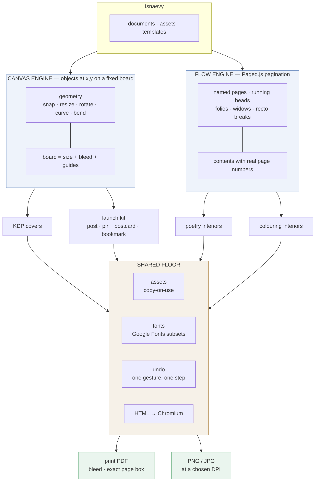

# Isnaevy: two engines on one shared floor

The shape settled on 29 September 2026. Rationale in `DECISIONS.md`, detail in
`isnaevy-plan.md`.

The thing to hold on to: **covers, posts, posters and pins are one artboard with
objects placed on it. Book interiors are not.** Pagination — running heads, folios,
widows, a contents page carrying real page numbers — is a different machine, and it
is the part of this that a competitor cannot cheaply copy. It keeps its own engine.

What the two engines share is the floor beneath them: the asset store, the fonts,
undo, and the one carefully-tuned path from HTML through headless Chromium to a PDF
with real embedded font subsets and an exact page box.

## Reading it

- **Both engines produce HTML.** That is the seam. Everything below the seam is
  shared and everything above it is free to differ. The canvas engine writes
  absolutely-positioned objects; the flow engine writes a document and lets
  Paged.js break it into pages. Neither has to know about the other.
- **The raster target is new** and is the only genuinely new thing in the export
  path: `page.screenshot` with `deviceScaleFactor = dpi / 96`, roughly thirty lines
  on top of the browser service that already exists.
- **A mode is thin.** It supplies board presets, guides (the spine and the barcode
  reserve come from here) and rules ("under 300 DPI", "crosses the spine"). `kdp.ts`
  stays exactly as it is and becomes one mode's rule source rather than a global
  truth.
- **Nothing crosses sideways.** The canvas engine never imports from the flow engine
  or the reverse. If that edge ever appears, something has been modelled wrong.
